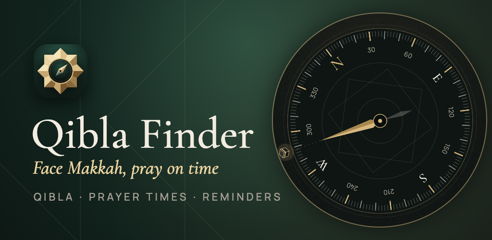
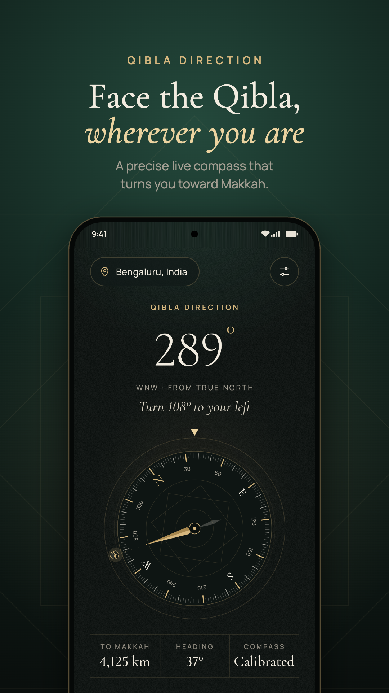
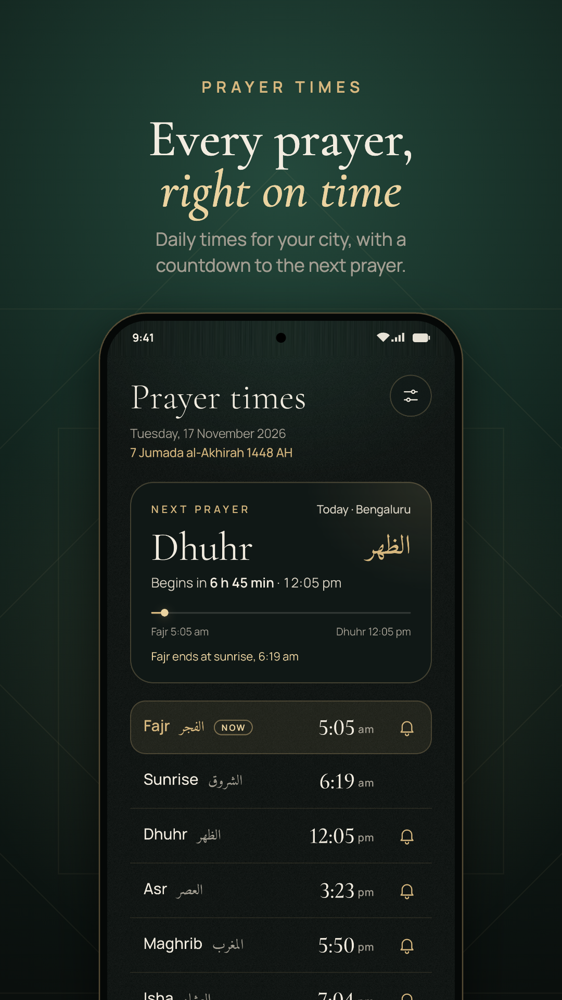
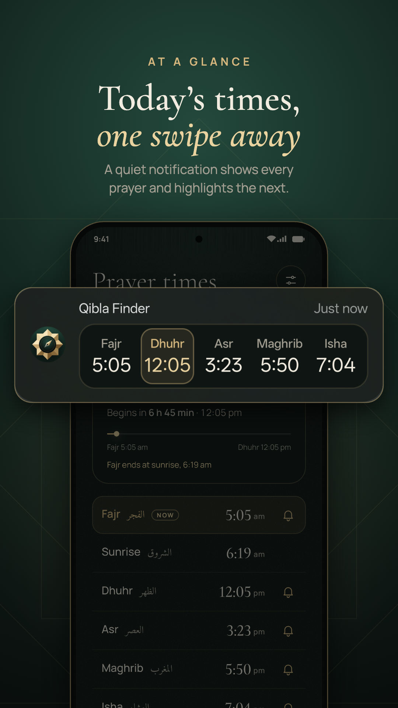
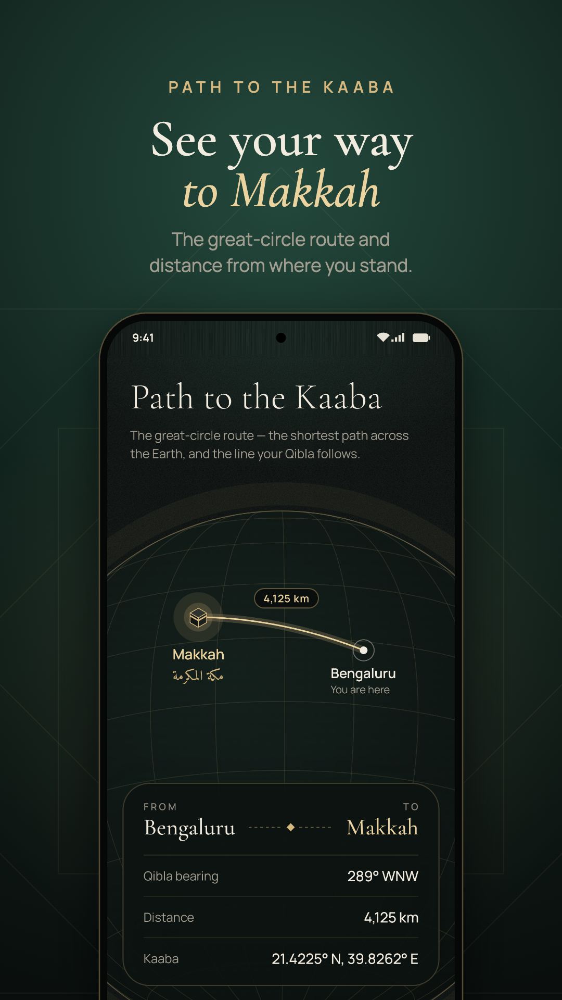
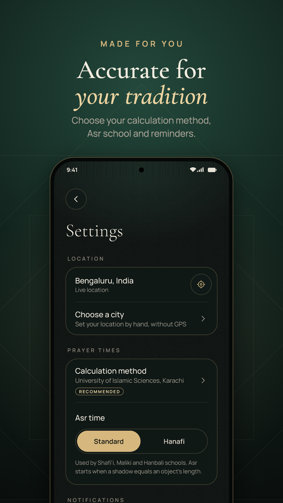
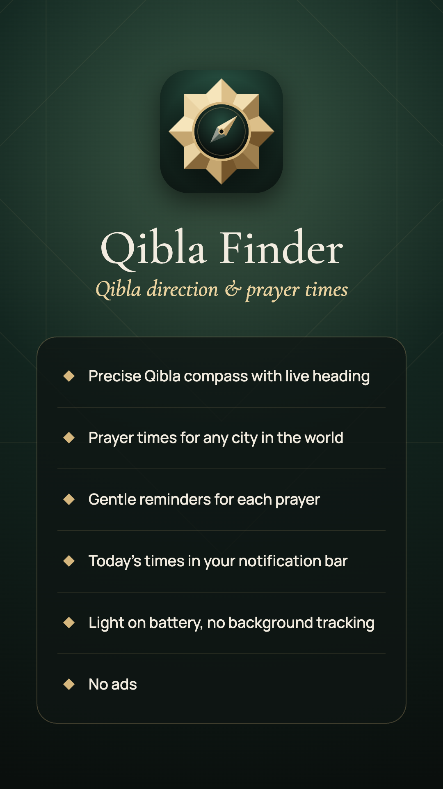

<div align="center">


# Qibla Finder

**Qibla direction & prayer times — precise, private and ad-free.**

<a href="https://play.google.com/store/apps/details?id=com.taslim.qiblafinder">
  
</a>




</div>

---

## About

Qibla Finder is a lightweight Android app that points you toward the Kaaba from anywhere in the world and keeps you on time for every prayer. It uses your phone's compass and location to show a live Qibla heading, calculates daily prayer times for your city, and gently reminds you when each prayer begins — all without ads and without tracking you in the background.

## Features

- 🧭 **Precise Qibla compass** — live heading that turns with your phone, with haptic feedback when you face the Qibla
- 🕌 **Prayer times for any city** — use live GPS or pick a city by hand, no GPS needed
- ⏳ **Next-prayer countdown** — see how long until the next prayer, plus sunrise and the Hijri date
- 🔔 **Gentle reminders** — per-prayer notifications you can switch on or off individually
- 📌 **Today's times in your notification bar** — a persistent notification that refreshes daily
- 🌍 **Path to the Kaaba** — the great-circle route, distance and bearing from where you stand to Makkah
- ⚙️ **Accurate for your tradition** — choose your calculation method and Asr school (Standard or Hanafi)
- 🔋 **Light on battery** — no background location tracking
- 🚫 **No ads**

## Screenshots

<div align="center">

| Qibla compass | Prayer times | Notifications |
|:---:|:---:|:---:|
|  |  |  |

| Path to the Kaaba | Settings | At a glance |
|:---:|:---:|:---:|
|  |  |  |

</div>

## Download

<a href="https://play.google.com/store/apps/details?id=com.taslim.qiblafinder">
  
</a>

👉 **[Qibla Finder on Google Play](https://play.google.com/store/apps/details?id=com.taslim.qiblafinder)**

Requires Android 8.0 (API 26) or newer, and a device with a compass (magnetometer) and accelerometer.

## Tech stack

| Area | Library / API |
|---|---|
| Language | Kotlin |
| UI | Jetpack Compose, Material 3, Navigation Compose |
| Location | Google Play Services Location |
| Prayer times | [Adhan](https://github.com/batoulapps/adhan-java) (`com.batoulapps.adhan`) |
| Sensors | Android `SensorManager` (magnetometer + accelerometer) |
| Scheduling | `AlarmManager` exact alarms + boot / time-change receivers |

## Project structure

```
app/src/main/java/com/taslim/qiblafinder/
├── MainActivity.kt            # Entry point
├── App.kt / AppState.kt       # Navigation and shared app state
├── OnboardingScreen.kt        # First-run permissions and setup
├── QiblaScreen.kt             # Live Qibla compass
├── PrayerScreen.kt            # Daily prayer times and countdown
├── RouteScreen.kt             # Great-circle path to the Kaaba
├── SettingsScreen.kt          # Location, calculation method, Asr school, reminders
├── CitySearch.kt              # Manual city selection
├── PrayerSchedule.kt          # Prayer time calculation (Adhan)
├── PrayerSettings.kt          # Persisted user preferences
├── PrayerReminders.kt         # Per-prayer reminder toggles
├── PrayerAlarmScheduler.kt    # Exact-alarm scheduling
├── PrayerAlarmReceiver.kt     # Fires prayer reminders
├── PrayerTimesNotification.kt # Ongoing "today's times" notification
├── DailyUpdateReceiver.kt     # Refreshes times each day
├── Bootreceiver.kt            # Restores alarms after reboot / update / clock change
├── Components.kt, MihrabIcons.kt
└── ui/theme/                  # Colors, typography, theme
```

## Building from source

**Requirements:** Android Studio (latest stable), JDK 11+, Android SDK 36.

```bash
git clone git@github.com:taslimmuhammed/qibla_finder.git
```

```bash
cd qibla_finder
```

```bash
./gradlew assembleDebug
```

The debug APK is written to `app/build/outputs/apk/debug/`. To install it directly on a connected device:

```bash
./gradlew installDebug
```

> The compass needs real sensors — use a physical device rather than an emulator for testing the Qibla screen.

## Permissions

| Permission | Why |
|---|---|
| `ACCESS_FINE_LOCATION` / `ACCESS_COARSE_LOCATION` | Calculate Qibla bearing and local prayer times (only while the app is in use) |
| `POST_NOTIFICATIONS` | Prayer reminders and the daily prayer-times notification |
| `SCHEDULE_EXACT_ALARM` / `USE_EXACT_ALARM` | Fire reminders exactly at prayer time |
| `RECEIVE_BOOT_COMPLETED` | Re-schedule reminders after the phone restarts |
| `VIBRATE` | Haptic feedback when facing the Qibla |

Location can be skipped entirely by choosing a city manually in Settings.

## Contributing

Bug reports and suggestions are welcome — please [open an issue](https://github.com/taslimmuhammed/qibla_finder/issues). If you enjoy the app, a review on [Google Play](https://play.google.com/store/apps/details?id=com.taslim.qiblafinder) helps others find it.

---

<div align="center">
Made with care by <a href="https://github.com/taslimmuhammed">Taslim Muhammed</a>
</div>
